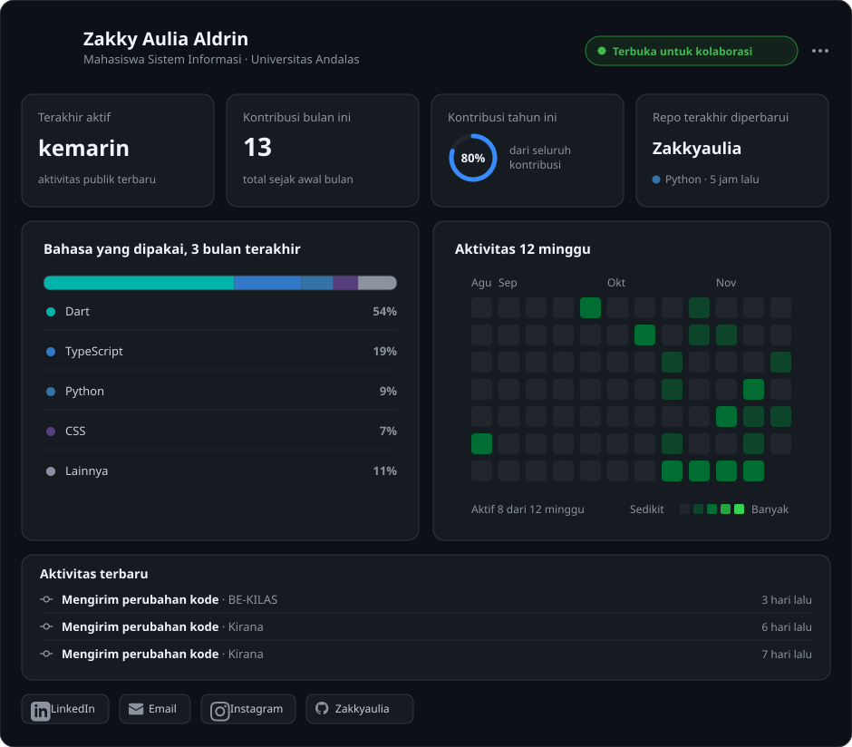

# Halo, Saya Zakky Aulia Aldrin 👋
### Mahasiswa Sistem Informasi · Universitas Andalas

<!-- GitHub Profile Dashboard SVG -->

 

<!-- Interactive Social Badges -->

  
  &nbsp;
  
  &nbsp;
  
  &nbsp;
  

---

### 🚀 Tentang Dashboard Ini

Dashboard ini dihasilkan secara otomatis menggunakan **Python** dan **GitHub Actions** yang berjalan setiap satu jam:
- **Data Asli**: Semua metrik ditarik langsung dari GitHub GraphQL & REST API resmi.
- **Waktu Aktif Terakhir**: Menghitung selisih waktu dari commit asli terakhir yang dibuat oleh akun.
- **Distribusi Bahasa (3 Bulan Terakhir)**: Dihitung berdasarkan penambahan baris kode (*lines changed*) dari commit qualifying selama 90 hari terakhir.
- **Heatmap 12 Minggu**: Menampilkan riwayat kontribusi 84 hari kalender terakhir secara dinamis.
- **Aktivitas Terbaru**: Menampilkan 3 event qualifying terbaru (commit, PR, repositori).

---

  Dashboard otomatis diperbarui setiap jam melalui <a href="https://github.com/Zakkyaulia/Zakkyaulia/actions">GitHub Actions</a> ⚡

